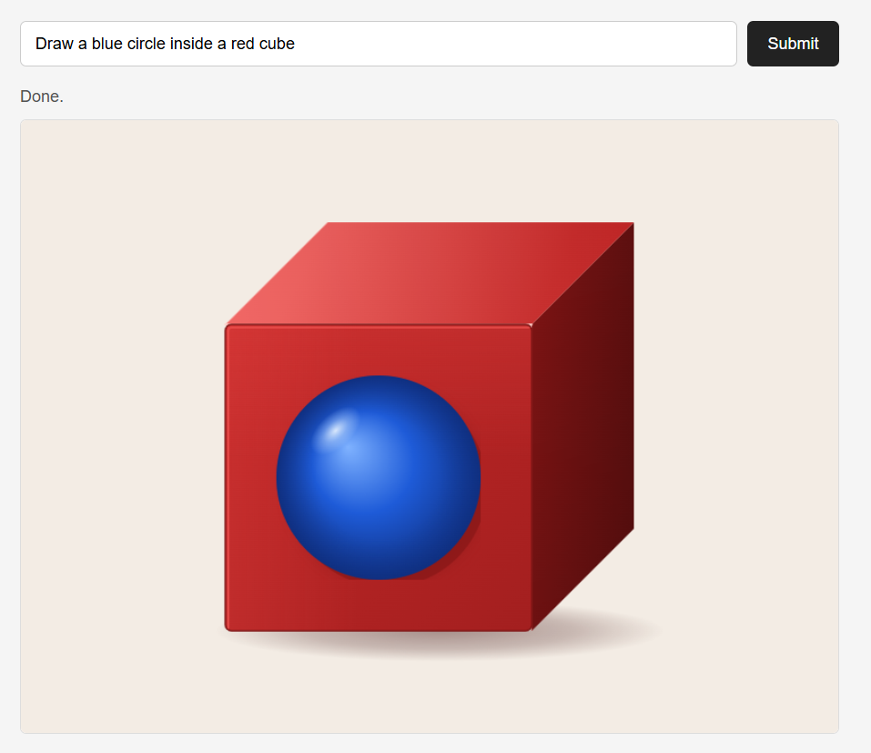
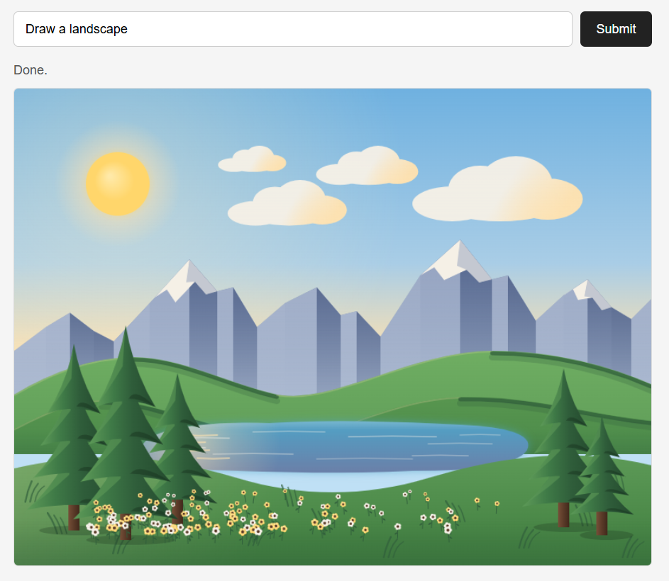
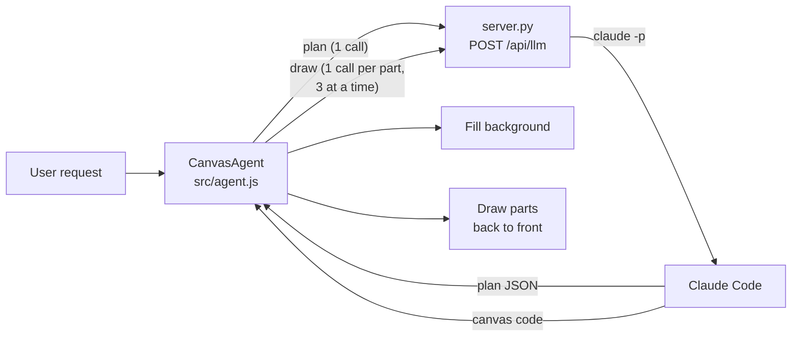
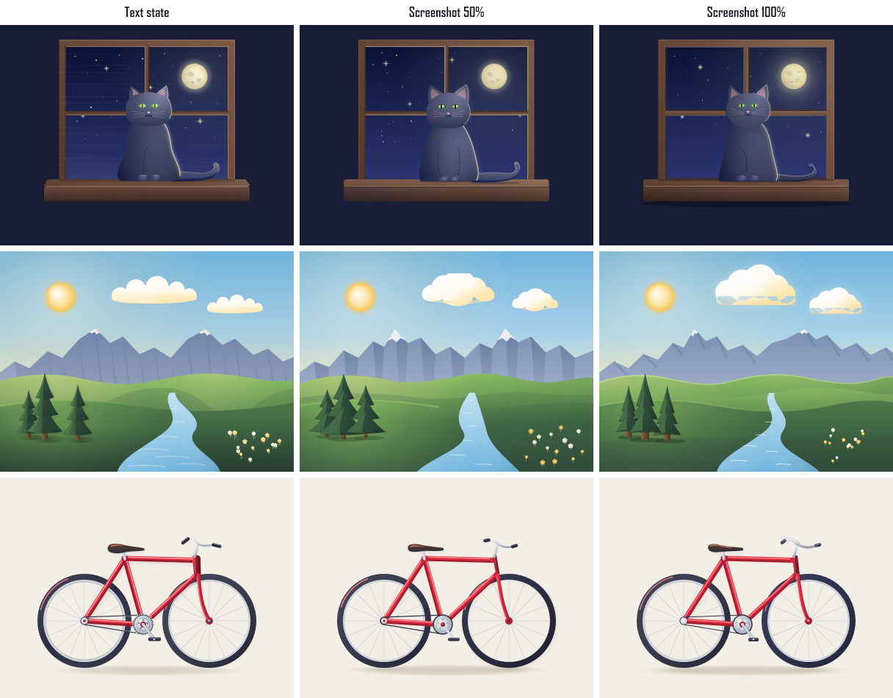

# Canvas AI

A small experiment in agent orchestration: describe a picture, and an LLM plans it as a list of parts, writes HTML Canvas code for each part, and the browser draws them back to front.

<p align="center">
  
  
</p>

## What this project is

This isn't a polished image generator. The point is the harness: a small, readable agent loop that shows

- **task decomposition**: one planning call turns a request into a list of self-contained parts;
- **structured output**: the plan comes back as compact JSON with positions, colors and descriptions;
- **code generation as a tool**: each part comes back as Canvas 2D JavaScript that the browser runs;
- **orchestration**: parts are requested in parallel but drawn strictly in back-to-front order;
- **recovery**: syntax errors are retried with the error message, and a failed part is skipped instead of stopping the drawing;
- **cost awareness**: short prompts, raw-code responses and per-call token logging.

It runs on the Claude Code CLI, so it uses your Claude Pro or Max subscription. No API key is needed.

## How it works



1. **Plan.** The agent sends the request and the canvas size. The model returns JSON like this:
   ```json
   {
     "background": "#f3ede4",
     "palette": ["#c62828", "#8e1414", "#1e5bd8", "#8fb8ff", "#fff6ee"],
     "light": "top-left",
     "parts": [
       { "name": "floor_shadow", "box": [230, 440, 380, 70], "desc": "Soft elliptical shadow..." },
       { "name": "blue_sphere",  "box": [300, 200, 170, 170], "desc": "Blue ball centered at (385,285), radius 85, radial gradient #8fb8ff to #1e5bd8..." }
     ]
   }
   ```
   Parts are listed back to front. `box` is `[x, y, width, height]` in canvas pixels, and `desc` holds everything needed to draw that part on its own: shape, technique, exact colors, and how it connects to its neighbours.
2. **Background.** The agent fills the canvas with `background` itself, without an LLM call.
3. **Draw requests.** For each part, the agent sends a four-line prompt, up to 3 at a time:
   ```
   Picture: Draw a blue circle inside a red cube
   Canvas: 800x600, light: top-left, palette: #c62828,#8e1414,...
   Other parts: floor_shadow [230,440,380,70]; cube_back_faces [240,110,320,340]; ...
   Draw "blue_sphere" in box [300,200,170,170]: Blue ball centered at (385,285)...
   ```
   The model replies with plain JavaScript (not JSON) that draws only that part. If the code has a syntax error, the agent asks once more and includes the error message.
4. **Draw.** As the code arrives, parts are drawn in plan order. Each part runs between `ctx.save()` and `ctx.restore()`, so its colors, transparency or shadows can't leak into the next part. If a part fails, it's skipped and named in the status line.

## Benchmark: text state vs. screenshot state

Each draw call needs some idea of what the rest of the picture looks like. The app gives it **text state**: the names and boxes of the other parts. This benchmark measures what happens when each call also gets a **screenshot** of the canvas drawn so far, and how many tokens that costs against how much image quality it adds.

<p align="center">
  
</p>

### Setup

| Variant | What each draw call receives | How parts are requested |
|---|---|---|
| Text state | The four-line prompt above (picture, canvas, other parts, this part) | 3 in parallel, as in the app |
| Screenshot 50% | The same prompt plus a 400×300 PNG of the canvas so far | One at a time, because a screenshot needs the earlier parts drawn first |
| Screenshot 100% | The same prompt plus an 800×600 PNG of the canvas so far | One at a time |

- 6 prompts, Claude Opus at effort `high`, called through `claude -p` exactly as `server.py` does, with the same `plan.md` and `draw.md` prompts.
- One plan per prompt is shared by all three variants, so the only difference between them is the state each draw call receives.
- Images are rendered headless with `@napi-rs/canvas`. Input token counts include cached input. Cost is the API-equivalent figure the CLI reports.
- Quality is scored by a blind judge (Opus, effort `medium`). It sees the three images unlabeled and scores each from 1 to 10 on **fidelity** (does it show what was asked), **coherence** (do the parts fit together in placement, overlap, perspective and lighting) and **craft** (shading, color and polish). Each prompt is judged twice with the images in opposite orders, and the two scores are averaged.

### Totals (6 prompts, 50 draw calls per variant)

| Variant | Input tokens | Output tokens | Cost | Fidelity | Coherence | Craft | Overall |
|---|---|---|---|---|---|---|---|
| Text state | 72,920 | 44,806 | $1.48 | 8.6 | 6.9 | 7.5 | **7.7** |
| Screenshot 50% | 83,958 (+15%) | 42,867 (−4%) | $1.53 (+3%) | 8.6 | 7.3 | 7.4 | **7.8** |
| Screenshot 100% | 107,619 (+48%) | 43,520 (−3%) | $1.73 (+17%) | 8.4 | 6.5 | 7.1 | **7.3** |

The image is the only thing that changes the input, so the extra tokens are almost exactly the screenshot's size. Output barely moves: the model writes about the same amount of code whether or not it can see the canvas. The 6 plan calls (7.9k input, 9.0k output tokens) are the same for every variant and are left out of these totals.

### Per draw call

| Variant | Input tokens per call | Extra vs. text state | Output tokens per call |
|---|---|---|---|
| Text state | 1,458 | – | 896 |
| Screenshot 50% | 1,679 | +221 | 857 |
| Screenshot 100% | 2,152 | +694 | 870 |

About 950 of the input tokens per call are fixed overhead from Claude Code, the same for all three variants.

### Per prompt

| Prompt | Parts | Text state (input / score) | Screenshot 50% (input / score) | Screenshot 100% (input / score) |
|---|---|---|---|---|
| Blue circle inside a red cube | 5 | 7,117 / 7.0 | 8,217 / 7.7 | 10,581 / 7.2 |
| Landscape | 9 | 12,804 / 8.3 | 14,802 / 7.0 | 19,066 / 6.5 |
| Red bicycle | 8 | 11,688 / 8.5 | 13,461 / 8.2 | 17,253 / 8.2 |
| Cat on a windowsill at night | 9 | 13,183 / 7.5 | 15,158 / 8.3 | 19,425 / 7.5 |
| Lighthouse at sunset | 8 | 11,646 / 7.2 | 13,410 / 7.7 | 17,189 / 7.7 |
| Bowl of fruit on a table | 11 | 16,482 / 7.5 | 18,910 / 7.7 | 24,105 / 7.0 |

The 50% screenshot scored highest on cube, cat, fruit and lighthouse, by 0.2 to 0.8 points. Text state scored highest on landscape (by 1.3) and bicycle (by 0.3).

### Time per drawing

Measured with no other benchmark runs competing for the CLI:

| Variant | Example drawings | Time per drawing | Time per part |
|---|---|---|---|
| Text state | bicycle (8 parts), cat (9 parts) | 77–95 s | about 10 s (3 calls in flight) |
| Screenshot 50% / 100% | cat (9 parts), fruit (11 parts) | 372–406 s | about 35–42 s (1 call in flight) |

The difference comes from ordering: a screenshot only exists once the earlier parts are drawn, so screenshot state rules out parallel calls.

### Observations

- The plan already gives every part exact pixel boxes, hex colors and a light direction, so the three variants produce very similar pictures for the same prompt (see the image above). The differences are local details, such as the scalloped cloud bottoms in the 100% landscape.
- Parts are drawn back to front, so a screenshot only shows what lies behind the current part. It shows nothing about the parts that will later overlap it in front.
- Coherence is the criterion that moves most: 6.9 for text state, 7.3 at 50% and 6.5 at 100%.

### Limits

- There is one run per prompt and variant, and the judge is itself a model. Scoring the same image in the two orders changed its score by 0.43 points on average (up to 1.33), and the two orders picked the same winner in 4 of 6 prompts. Treat differences under about 0.5 points as within noise.
- The screenshot variants add the image on top of the text state rather than replacing it.
- Two text-state runs first lost one part each to a CLI timeout, with about 30 calls running at once. They were re-run alone, and those re-runs are the ones reported. The originals are kept in `bench/results/` as `*.timeout-run.*`.

### Reproduce

The harness is in [`bench/`](bench/README.md):

```bash
cd bench
npm install
node run.mjs      # plan + draw every prompt × variant into results/ (resumable)
node judge.mjs    # blind judge, two image orders per prompt
node report.mjs   # results/summary.md and summary.json
node page.mjs     # results/report.html with every image side by side
```
